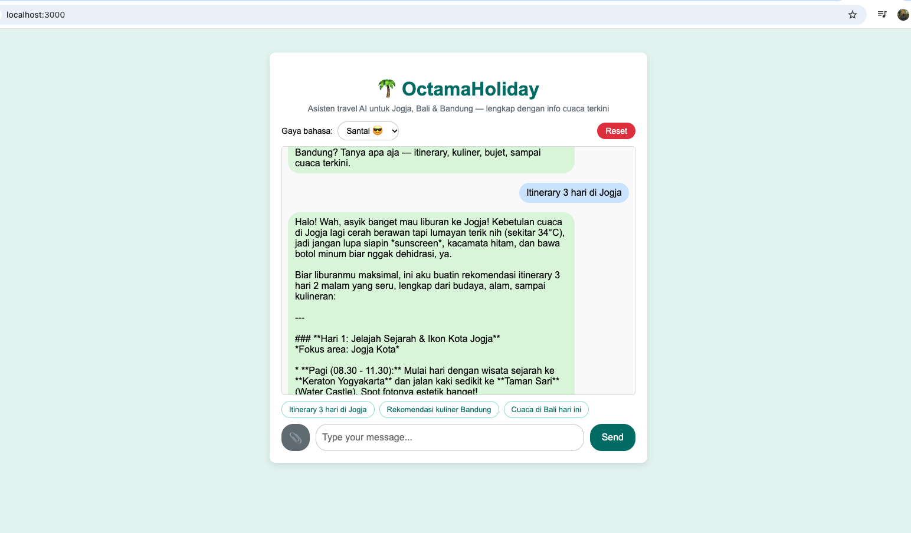

# OctamaHoliday



**Author:** Indra Octama

**OctamaHoliday** — (NusaTrip as inspiration) chatbot travel assistant berbasis **Google Gemini API** (model: `gemini-3.8-flash`) dengan ExpressJS + web UI. Ahli pariwisata **Jogja, Bali, dan Bandung**: rekomendasi destinasi, itinerary, kuliner, transportasi, dan estimasi bujet.

Berdasarkan materi Sesi 2 & 3 — Eksplorasi Gemini AI API.

## Fitur Kreatif

- **Gaya bahasa formal/santai** — dipilih dari dropdown di UI, diteruskan ke `systemInstruction`
- **Domain pengetahuan pariwisata** — persona khusus Jogja, Bali, dan Bandung
- **Integrasi API eksternal** — cuaca real-time [Open-Meteo](https://open-meteo.com/) (tanpa API key) disisipkan ke konteks model
- **Memory percakapan** — riwayat chat disimpan di SQLite (`node:sqlite`, file `chat.db`) per `sessionId`, tetap nyambung setelah refresh
- **Rekomendasi & suggestion chips** — tombol pertanyaan cepat di UI

## Persiapan Awal (Checklist)

Sebelum menjalankan aplikasi, pastikan sudah tersedia:

- **Node.js v18+** — cek dengan `node --version` ([panduan instalasi](https://nodejs.org/))
- **Akun Google** — untuk mengakses Google AI Studio dan membuat API key
- **Gemini API key** — lihat langkah di bawah
- **VS Code** (atau code editor lain)
- **Postman** (atau `curl`) — untuk menguji API
- **Aset uji coba** (opsional) — file gambar, dokumen, dan audio untuk mengetes endpoint upload

## Cara Membuat Gemini API Key

1. Buka **Google AI Studio**: https://aistudio.google.com/api-keys
2. Login dengan akun Google kamu.
3. Klik tombol **"Create API Key"**.
4. Pilih project Google Cloud yang ada (atau buat baru jika diminta).
5. **Salin API key** yang dihasilkan — simpan baik-baik, key ini rahasia dan tidak boleh di-commit ke repository.
6. Masukkan key tersebut ke file `.env` (lihat bagian Konfigurasi).

> API key gratis tersedia melalui free tier dengan rate limit tertentu. Dokumentasi: https://ai.google.dev/gemini-api/docs

## Instalasi

```bash
git clone https://github.com/indraoct/project-slide2-ai-hacktiv8.git
cd project-slide2-ai-hacktiv8
npm install
```

## Konfigurasi

Buat file `.env` di root project:

```env
GEMINI_API_KEY=your_api_key
GEMINI_MODEL=gemini-3.8-flash
PORT=3000
```

> `.env` sudah terdaftar di `.gitignore` — jangan pernah commit file ini karena berisi API key rahasia.

## Menjalankan

```bash
npm start
```

atau mode auto-reload saat development:

```bash
npm run dev
```

Server berjalan di `http://localhost:3000`.

## Menjalankan dengan Docker & Makefile

Prasyarat: [Docker Desktop](https://www.docker.com/products/docker-desktop/) dan `make` (sudah bawaan macOS/Linux). Pastikan `.env` sudah berisi `GEMINI_API_KEY`.

```bash
make docker-up     # build image + jalankan container (background)
make docker-logs   # lihat log secara live
make docker-down   # stop & hapus container
```

Tanpa Docker, Makefile juga membungkus perintah lokal:

```bash
make install       # npm install
make dev           # npm run dev (auto-reload)
make start         # npm start
make reset-db      # hapus memory chat (chat.db)
make help          # daftar semua perintah
```

Memory percakapan (SQLite) di container disimpan di volume `chat-data` sehingga tetap ada setelah container restart — hapus permanen dengan `docker compose down -v`.

## Web UI (Chatbot)

Buka `http://localhost:3000` di browser untuk menggunakan **NusaTrip** (folder `public/`). UI mendukung:

- **Chat teks** — dikirim ke `/chat` dengan memory percakapan
- **Toggle gaya bahasa** — Santai / Formal
- **Suggestion chips** — klik untuk langsung bertanya
- **Tombol Reset** — hapus riwayat chat dan mulai sesi baru
- **Upload file** (tombol 📎) — gambar, dokumen, dan audio otomatis diarahkan ke endpoint masing-masing berdasarkan tipe file

## Endpoints

### POST /chat

Endpoint utama chatbot. Body — raw JSON:

```json
{ "message": "Itinerary 3 hari di Bali", "sessionId": "abc-123", "style": "santai" }
```

- **message** (wajib): pesan pengguna
- **sessionId** (opsional, default `"default"`): identitas sesi untuk memory
- **style** (opsional): `"santai"` atau `"formal"`

### GET /chat/:sessionId/history

Mengambil seluruh riwayat percakapan sebuah sesi.

### DELETE /chat/:sessionId

Menghapus riwayat percakapan sebuah sesi.

### POST /generate-text

Body — raw JSON:

```json
{ "prompt": "Explain how AI works in a few words" }
```

### POST /generate-from-image

Body — form-data:

- **image** (File): `.png`, `.jpg`, dll.
- **prompt** (Text, opsional): mis. `Describe this image`

### POST /generate-from-document

Body — form-data:

- **document** (File): `.pdf`, `.txt`, dll.
- **prompt** (Text, opsional): mis. `Summarize this document`

### POST /generate-from-audio

Body — form-data:

- **audio** (File): `.mp3`, `.wav`, dll.
- **prompt** (Text, opsional): mis. `Transcribe this audio`

## Catatan

File yang diupload diproses dari memory buffer (via `multer`), dikonversi ke Base64, dan dikirim ke Gemini sebagai `inlineData` — tanpa penyimpanan ke disk.
